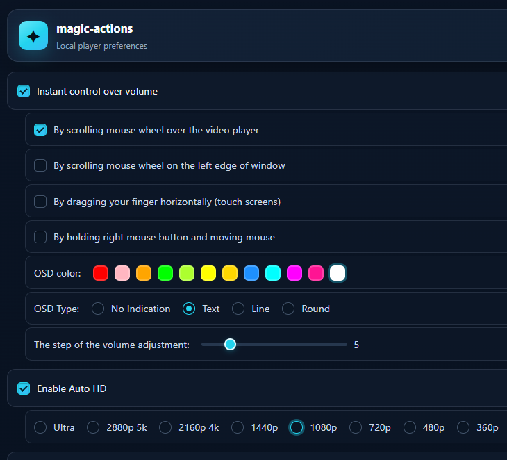
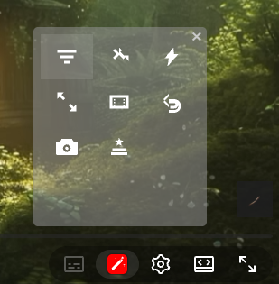

# magic-actions


A lightweight, local-first Chrome extension that adds useful controls, visual tools, and player customisation to YouTube.

## Highlights

- Extended controls directly inside the YouTube player
- Cinema and expanded viewing modes
- Playback speed and repeat controls
- Snapshot capture
- Video filters and transforms
- Redesigned local options interface
- Settings stored locally in the browser
- No telemetry, analytics, advertising, or remote configuration backend
- Manifest V3 architecture

## Screenshots

### Options

Take a screenshot of the extension's **Options** page with the redesigned interface visible. Use a clean state with several settings shown so the colour scheme, typography, switches, and layout are easy to recognise.

Save it as:

```text
docs/screenshots/options.png
```

Recommended capture: approximately **1200 × 800 px** or a similar 3:2 / 16:10 crop.

<!-- After adding the screenshot, remove this comment and uncomment the line below. -->
<!--  -->

### Player toolbar

Open a normal YouTube video, open the **magic-actions toolbar**, and take a screenshot that clearly shows the toolbar together with enough of the YouTube player to make the integration obvious.

Save it as:

```text
docs/screenshots/player-toolbar.png
```

Recommended capture: approximately **1600 × 900 px**. Avoid showing personal account information, recommendations, notifications, or browser profile data where possible.

<!-- After adding the screenshot, remove this comment and uncomment the line below. -->
<!--  -->

## Installation

1. Download or clone this repository.
2. Open Chrome and navigate to `chrome://extensions/`.
3. Enable **Developer mode**.
4. Select **Load unpacked**.
5. Choose the `magic-actions` directory.

The extension requires **Chrome 121 or newer**.

## Usage

Once installed, magic-actions automatically integrates with supported YouTube pages.

- Click the extension icon to open the local Options interface.
- Open the magic-actions control in the YouTube player to access player tools.
- Right-click the extension icon and choose **New Version** when you want to check for a newer project version.

## Player tools

The in-player toolbar provides quick access to:

- **Tone Filters** — cycle through video filter effects
- **Canvas Transform** — apply supported visual transforms
- **Boost Playback** — use the buffering/playback helper
- **Expand View** — enlarge the player layout
- **Cinema Mode** — switch to the cinema presentation
- **Toggle Loop** — enable or disable repeat; use the mouse wheel to adjust playback speed
- **Take Snapshot** — capture the current video frame locally
- **Local Options** — open the extension settings

## Privacy

magic-actions is designed to operate locally.

It does **not** use:

- telemetry
- analytics
- advertising services
- remote configuration services
- external tracking services

Extension preferences are stored through Chrome's local extension storage. Network access is limited to the YouTube pages on which the extension operates.

## Project structure

```text
magic-actions/
├── manifest.json
├── esw30.js
├── eopt30.html
├── gjs30/
│   ├── eopt30.js
│   ├── ewatch30.js
│   └── emusic30.js
├── gcss30/
│   ├── eopt30.css
│   └── etheme30.css
├── gimg30/
│   └── ... local UI assets
├── _locales/
│   └── en/messages.json
└── docs/
    └── screenshots/
```

## Development

The extension uses Chrome Manifest V3 and is intentionally self-contained:

- `esw30.js` manages extension-wide state and browser actions.
- `gjs30/ewatch30.js` integrates the main controls into YouTube.
- `gjs30/emusic30.js` handles YouTube Music and embedded-player behaviour.
- `gjs30/eopt30.js` manages the local Options interface.
- `gcss30/` contains the extension and player styling.

No external runtime libraries or remote configuration files are required.

## Author

**deadsway**

## Contributing

Issues and pull requests are welcome. Keep changes focused, document user-facing behaviour, and avoid adding unnecessary external runtime dependencies.
